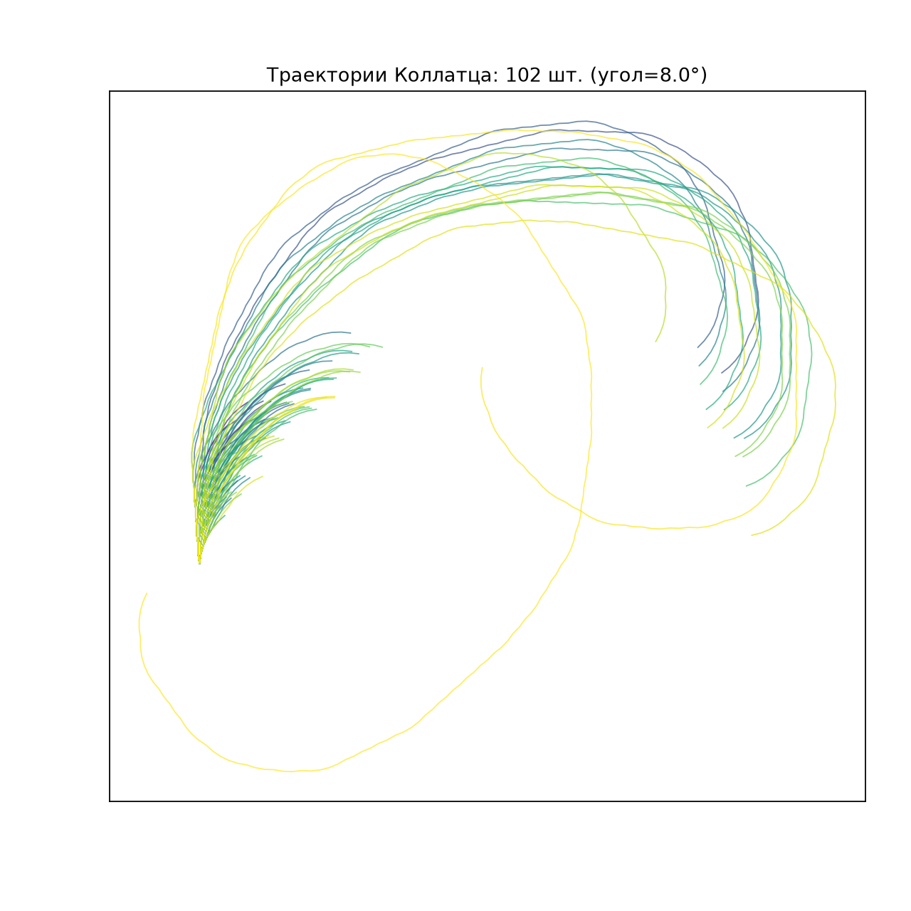
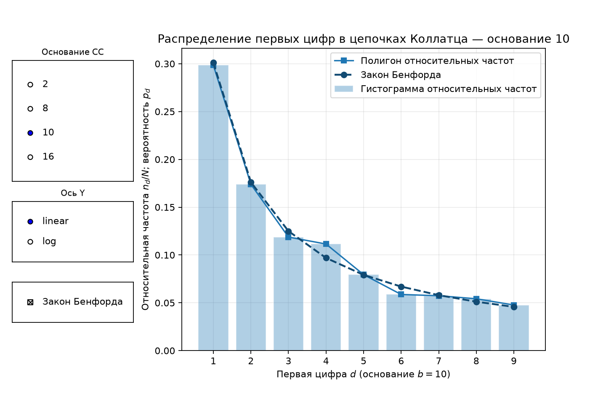

# Collatz Explorer

Исследование последовательностей Коллатца на C++20 с интерактивными графиками
на Python. Программа обрабатывает старты от 1 до N и сохраняет статистику
без необходимости держать все цепочки в памяти.

## Что можно исследовать

| Данные | Представление |
|---|---|
| Длины цепочек | Гистограмма и выборочная функция распределения |
| Чётные и нечётные шаги | Сравнение распределений |
| Максимумы цепочек | Доли и накопленные доли по логарифмическим интервалам |
| Первые цифры в основаниях 2…36 | Сравнение с законом Бенфорда |
| Отдельные траектории | Coral-график с настройкой угла |

Длина — число обычных шагов до первого достижения 1. Первые цифры считаются
для всех значений каждой цепочки, включая старт и последнюю 1;
общие хвосты разных цепочек учитываются повторно.

## Установка и первый запуск

Нужны CMake 3.20+, компилятор C++20 с `std::jthread` и Python 3.14 для графиков.
На macOS требуются Xcode / Command Line Tools 26 или новее.
JSON-библиотека включена в исходники; C++-сборке доступ к сети не требуется.
Команды выполняются из корня проекта.

macOS/Linux:

```bash
python3 -m venv .venv
.venv/bin/python -m pip install --no-user -r requirements.txt
./build.sh examples/quickstart.json output
.venv/bin/python python/visuals/demo.py --input-dir output
```

Windows PowerShell с установленным компонентом Visual Studio для C++:

```powershell
py -3.14 -m venv .venv
.\.venv\Scripts\python.exe -m pip install --no-user -r requirements.txt
.\build.ps1 -Mode release -Python .\.venv\Scripts\python.exe -ConfigPath examples/quickstart.json -OutputDirectory output
.\.venv\Scripts\python.exe python/visuals/demo.py --input-dir output
```

Быстрый пример обрабатывает 10000 стартов. Для миллиона используйте `config.json`:
`./build.sh config.json output`. Каждый расчёт создаёт отдельный набор
в `output/collatz_runs/run-…/`; его путь печатается после завершения.
Галерея выбирает последний готовый набор и открывает пять окон.

Сохранение графиков без открытия окон:

```bash
.venv/bin/python python/visuals/demo.py --input-dir output --save-dir output/figures --no-show
```

Параметры, отдельные графики и форматы результатов описаны в
[справочнике](docs/api.md). Сборка без скриптов и тесты — в
[руководстве по разработке](docs/development.md).

## Время выполнения

Миллион стартов, 4 потока, основания `[2, 8, 10, 16]`, кэш 100000,
блок 10000, 100 интервалов. macOS arm64, Apple Clang 21, Release с LTO;
медианы семи запусков.

| Режим | Время |
|---|---:|
| Только сводка | 0.042 с |
| CSV и сводка | 0.195 с |

Включены запуск процесса, расчёт и сохранение набора с паспортом.
Сборка и графики не включены. [Исходные замеры](benchmarks/output-publication.json);
на другой машине время может отличаться.

## Примеры графиков

Траектории для 102 стартовых чисел: 1…100, 703 и 871; угол 8°.



Первые цифры в десятичной системе для цепочек со стартами 1…1000000.
Линия Бенфорда служит ориентиром для сравнения.



## Ограничения и документация

Значения цепочки ограничены `uint64_t`, одна цепочка — 60000 обычными шагами.
Переполнение или превышение лимита завершают расчёт с ошибкой.
`memory_budget_mb` ограничивает предварительную оценку рабочих данных, а не RSS.
Граница N=10¹² задаёт допустимый ввод, а не обещание практической скорости.
Проект не доказывает гипотезу Коллатца и не предполагает закон Бенфорда для этих данных.

- [Запуск, конфигурация, форматы и графики](docs/api.md)
- [Алгоритм, структура и измерения](docs/algorithms.md)
- [Сборка, тесты и состояние CI](docs/development.md)

## Лицензия

[BSD-3-Clause](LICENSE). Лицензии зависимостей и уведомления —
в [THIRD_PARTY_NOTICES.md](THIRD_PARTY_NOTICES.md).
